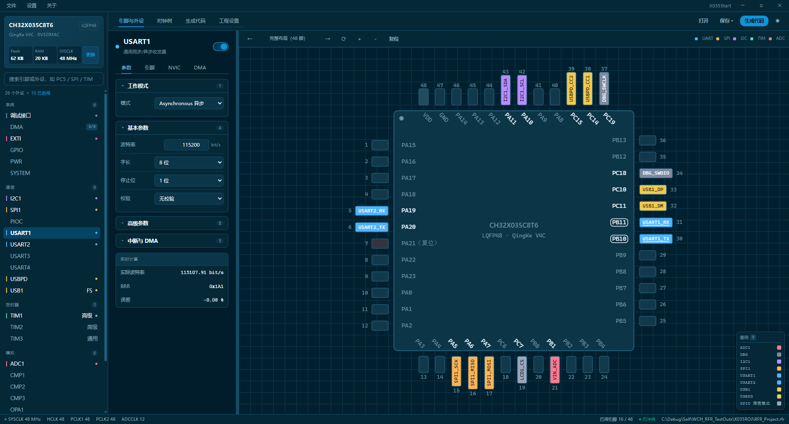

# RiskFiveRuler

面向 **WCH CH32** 与 **Holychip 芯圣 HC32** 的图形化 MCU 引脚 / 外设配置与代码生成工具（Windows 桌面端）。

左侧选外设、中间配参数、右侧点引脚；内置时钟树与目标主频一键求解，最后导出可编译的工程或引脚映射表。



> 仓库地址：Gitee <https://gitee.com/LoveFinderSeriesOfficial/LoveFinder967-RiskFiveRuler> · GitHub <https://github.com/48832668/LoveFinder967-RiskFiveRuler>

## 功能

- **图形化引脚配置**：点击封装图上的引脚，弹出该脚全部可用功能（复用 / EXTI / GPIO 模式），选中即落到配置。
- **外设参数**：USART、SPI、I2C、TIM（含互补 / 死区 / 刹车）、ADC（规则 / 注入 / 看门狗）、CAN、USB、USBPD、EXTI、DMA、NVIC、RTC、PWR、IWDG、WWDG、OPA、CMP。
- **引脚规划与冲突检测**：同组重映射约束、自动让位、冲突高亮、一键释放冲突外设。
- **时钟树**：时钟源 / PLL / 总线分频可视化；「目标工作频率」一键求解，启用 USB 全速时自动修正到可派生 48 MHz 的合规主频。
- **调试接口**：2 线 / 1 线 SDI（按器件能力）、调试器冻结位。
- **DMA 分配**：按硬件请求挑通道，汇总已用 / 冲突。
- **引脚锁定**：锁定单个引脚或某外设的映射组，自动规划会绕开。
- **自定义引脚名**：名字直接显示在引脚色块中，并写入生成代码注释。
- **主题**：任意 RGB 主题色派生出整套配色，明暗双模式；分栏可拖拽。
- **新手模式**：仅在开启时显示寄存器 / 原理类提示。

## 支持的器件

| 厂商 | 系列 | 型号（封装） | 代码生成 | 可导出 |
| --- | --- | --- | --- | --- |
| WCH | CH32L103 | C8T6 (LQFP48) · K8U6/K8U7 (QFN32) · G8R6 (QSOP28) · F8U6 (QFN20) · F8P6 (TSSOP20) | ✅ SPL（无官方 EVT，未做编译验证） | MRS 工程 / Makefile / 引脚表 |
| WCH | CH32X035 | R8T6 (LQFP64M) · C8T6 (LQFP48) · G8U6 (QFN28) · G8R6 (QSOP28) · F8U6 (QFN20) · F7P6 (TSSOP20) · D8U6 (QFN12) | ✅ SPL | 同上 |
| WCH | CH32X033 | F8P6 (TSSOP20) | ✅ SPL | 同上 |
| WCH | CH32V407 | VET6 (LQFP100) · WEU6 (QFN68) · RET6 (LQFP64) · KEU6 (QFN32) | ✅ SPL | 同上 |
| WCH | CH32V467 | VET6 (LQFP100) · WEU6 (QFN68) · RET6 (LQFP64) · KEU6 (QFN32) | ✅ SPL | 同上 |
| Holychip 芯圣 | HC32F401B | RET6YM (LQFP64) · KEU6YM (LQFP32) · KCU6RM1/RM2 (QFN32) · ECU6RM (QFN24) | ❌ 仅引脚 / 复用数据 | 仅引脚映射表 |

> WCH 系列按官方 SPL 生成；X035 / X033 / V407 / V467 已对照官方 EVT 头文件并做 gcc 语法检查。
> HC32F401B 目前只有引脚与复用功能资料，不生成初始化代码，只导出 `rfr_pinmap.h` 供对照。

## 导出格式

**MounRiver Studio 工程（WCH）** —— 可直接 Import：

```
<User>/
├── .project / .cproject / .template   工程描述
├── main.c                             MRS 例程风格入口
├── rfr_init.c/h · rfr_pinmap.h        外设初始化与引脚宏
├── ch32xxx_it.c/h · system_ch32xxx.c/h · ch32xxx_conf.h
└── Core / Startup / Ld / Peripheral / Debug   随工程生成的库目录（自包含）
```

**Makefile 工程（WCH）** —— `Core/Inc` + `Core/Src` + `Makefile` 经典布局。

**引脚映射表（全部器件）** —— `rfr_pinmap.h`：每个已配置信号的引脚宏与复用编号（WCH 为重映射组号，HC32 为 AF 号）。

## 使用

1. 启动进入欢迎页：新建工程 / 打开工程 / 最近打开。
2. 选择器件：系列 → 型号 → 确认资源。
3. 左侧树选外设、中间配参数；或直接在右侧引脚图上点引脚分配功能。
4. 「时钟树」设定目标主频（可一键求解）；启用 USB 时自动保证可派生 48 MHz。
5. 保存工程。工程已有路径后「生成代码」直接输出到工程目录，未保存时隐藏该入口。
6. 「导出引脚表」在任意器件上可用。

快捷键：`Ctrl+N` 新建 · `Ctrl+O` 打开 · `Ctrl+S` 保存 · `Ctrl+Shift+S` 另存为 · `Ctrl+E` 导出。

## 运行 / 构建

用户端：Windows 10 1803+ / Windows 11（自带 WebView2 Runtime）。把 `RiskFiveRuler.exe` 与 `WebView2Loader.dll` 放同一目录，双击即用，无需 Node / .NET。

> `WebView2Loader.dll` 是 exe 的**静态导入依赖**（PE 导入表里的 `CreateCoreWebView2EnvironmentWithOptions`），缺了它 Windows 加载器会直接拒绝启动，不是可选组件。因此发布一律用 zip 包，不能只发单个 exe。请解压到**可写目录**（不要放 `C:\Program Files`）。

界面偏好保存在 exe 同目录的 `config.json`（主题色 / 明暗 / 新手模式 / 引脚配色）。发布包里**不带**这个文件：首次启动时程序会用默认值自动创建并初始化；放到只读目录导致写不进去时会自动降级为内存默认值，不影响运行。设置界面也支持导入 / 导出该文件。

从源码构建：

```bash
npm install
npm run tauri:dev      # 开发模式（Tauri + Vite）
npm run package:exe    # 打包便携 exe 到仓库根目录
```

## 说明

- 器件数据来自各厂商数据手册 / 参考手册：WCH 的引脚与复用逐脚核对；HC32F401B 的封装引脚号是按端口顺序推导的序号，非物理脚号。
- 生成代码按各系列真实的 SDK API 输出，不同系列的头文件前缀与寄存器函数名不同。
